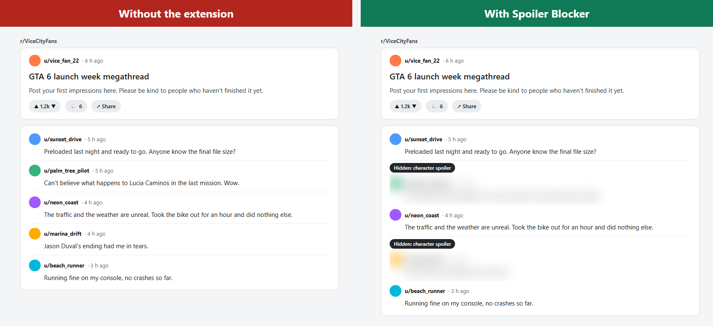
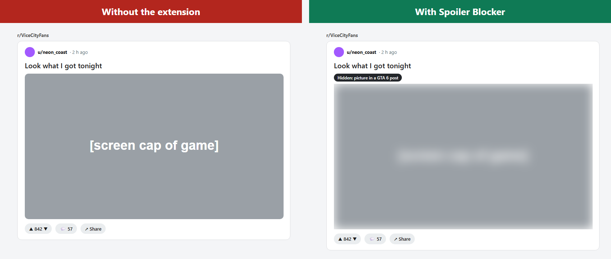
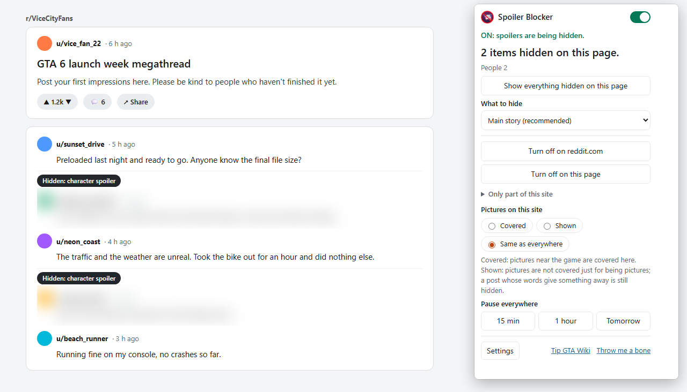
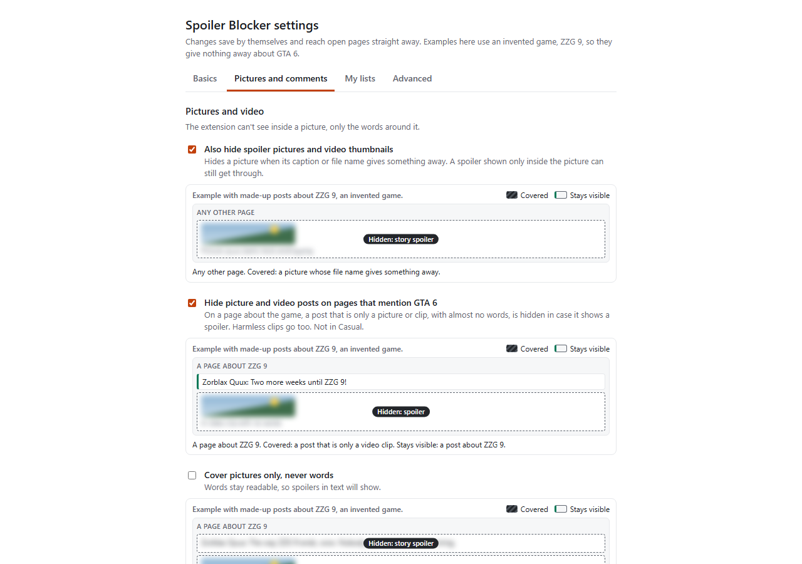

# Spoiler Blocker for GTA 6

Chrome Web Store: under review; until then [install from GitHub below](#installation-guide).

There was an extension a long time ago for blocking spoilers for Star Wars: Episode 7 when it came out (before we knew it was bad). I was wondering how to replicate that without having to read the plot and block things myself, which would require spoiling myself in order to add the spoilers.

This extension watches the community-run GTA wiki, labels new names and details as they are added, and publishes the result as one list that the extension downloads. The contents are fed through and labeled by Claude, tuned by me providing human labeling on a large number of items and giving it rules. In its current state it has around 85% correct labeling of unknown data in the GTA wiki during testing. It blocks spoilers in your browser, based on the settings you choose.

## Installation guide

Use this if you want the extension before the store has it, or you do not use the store.

### First install

1. Open the [releases page](https://github.com/907-ClubMember/gta-spoil-blocker-extension-/releases/latest) and download the file ending in `-chrome.zip` (not "Source code").
2. Unzip it into a folder you will keep, for example "Documents/spoiler-blocker". Do not use your Downloads folder or a temporary folder.
3. Open `chrome://extensions` and turn on **Developer mode** (top right).
4. Press **Load unpacked** and pick the unzipped folder.
5. Pin the icon: click the puzzle-piece menu next to the address bar and pin Spoiler Blocker for GTA 6.

### Updating

When a newer version is out, the extension's popup tells you, and its **How to update** button shows these same steps.

1. Download the latest zip from the [releases page](https://github.com/907-ClubMember/gta-spoil-blocker-extension-/releases/latest): the file ending in `-chrome.zip`, not "Source code".
2. Unzip it **over the same folder you loaded before**: pick that folder as the destination, or copy the files into it and choose Replace. A different folder is a separate copy that starts with default settings.
3. Open `chrome://extensions` and press **Reload** on the extension's card, then refresh the pages you have open.

Your settings stay as long as you use the same folder. The extension never downloads the new version itself: it only opens the releases page when you press the link.

### Developer-mode reminder

Chrome may show a reminder about developer-mode extensions when it starts; you can dismiss it.

### Uninstalling

1. Open `chrome://extensions` and press **Remove** on the extension's card.
2. If you want, delete the folder you unzipped it into.

## Screenshots

## What it does

- Works on YouTube (including live chat), Reddit (old and new), X, Bluesky, Facebook, Instagram, Twitch, Kick, Discord (web), Steam (store and community), Google, Bing, DuckDuckGo and Gmail, with basic support for other websites.
- Hides the whole post or comment.
- Hides everything from a known spoiler account, and you can add your own.
- You choose how much to protect: only the big moments, the main story (the default), or everything to be extra safe.
- Official trailers from the publisher and major game news channels play as normal, if you want or are blocked
- Reaction GIFs in replies are shown if they are judged likely to be safe; reply photos stay covered unless you choose to show them, as they cannot be confirmed safe with a high level of confidence.
- Hover over a cover to see why it is hidden. The label never shows the spoiler itself, only the reason it was hidden.
- Safe and strict site lists, your own words to hide, and words never to hide.
- Works alongside common extensions such as ad blockers and dark-mode tools.

## Limitations

It reads words, not meaning. A comment that tells the story in plain words, with no name or spoiler word in it, can still get through. It also cannot see inside a picture, only the words around it. This means that if someone posts a spoiler image on a page that has no content related to GTA 6, it can get through. I would use this as a final layer of spoiler protection after blocking keywords on sites and leaving GTA 6-related communities. Because this is a Chrome extension, it only has support on desktop Chrome; mobile social media apps such as Reddit and X could still be a risk. It is meant for after you have taken all other precautions.

About 85% correct labeling in testing; on GTA 6's wiki so far it has missed no spoilers and leans toward hiding more than needed.

## Report a problem

Something missed, something hidden that should not be, or a page that looks broken? Open an [issue](https://github.com/907-ClubMember/gta-spoil-blocker-extension-/issues/new/choose) and pick the form that fits:

- **Missed spoiler**: something that should have been covered was not.
- **Wrong hide**: something harmless was covered.
- **Broken page**: the extension breaks or misplaces a page.

**Never type a spoiler or a name from the game.** The forms never ask for one: you choose the site, paste the page link and tick three boxes. A program reads the reports, not a person, and a report that names something on the list, or that comes from a brand-new account, is moved out of sight automatically. Before you send one, look at the **Why** panel in the popup: a page can be left alone because the site is paused, the list is out of date, or a name needs the game mentioned next to it. That is by design, not a bug.

## Privacy

I am not interested in your data. Pages are read only inside your browser. No account, no tracking, no analytics. The only download is the spoiler list itself. The code is open source on GitHub.

## Browser support

Currently only in the Chrome Web Store. The zip can be taken from GitHub and loaded in other Chromium browsers. [This is untested as the browser has only been tested in chrome]

## AI notice

Made heavily with AI, with hand-checking against earlier games to correct classification issues and push the labeling in the right direction. The artwork is human-made, taking a very very grueling 30 seconds to make in illustrator.

## Credits

Thanks to the volunteer editors of GTA Wiki, whose work the list is built on (text under CC BY-SA). If this saved your playthrough, consider donating or contributing to them.

## Disclaimer

Not affiliated with, endorsed by or connected to Rockstar Games, Take-Two Interactive or gta.wiki. Grand Theft Auto and GTA are trademarks of Take-Two Interactive.
